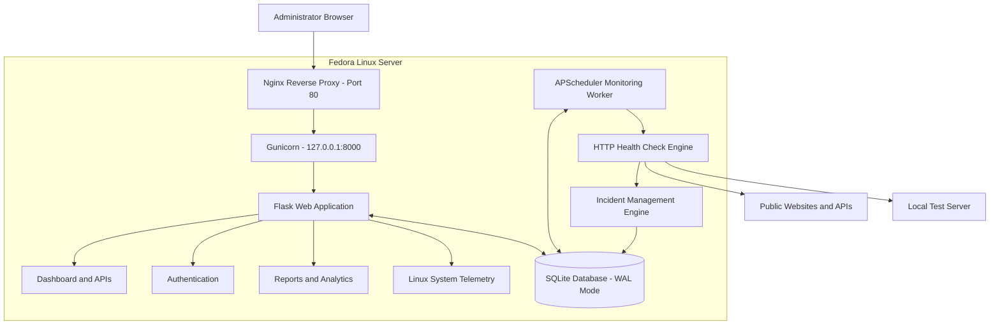
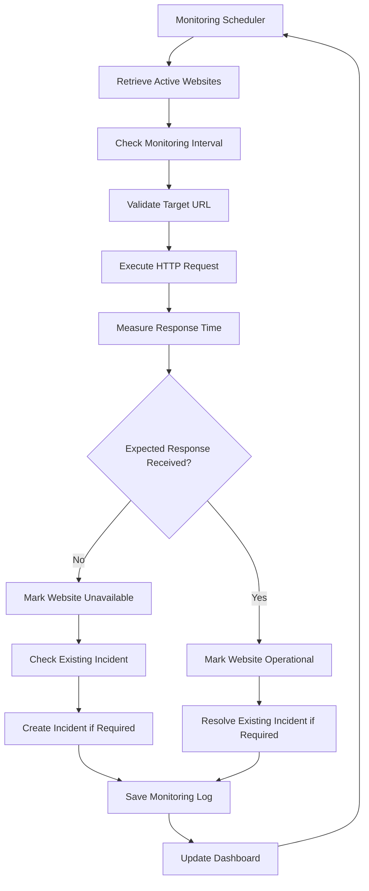
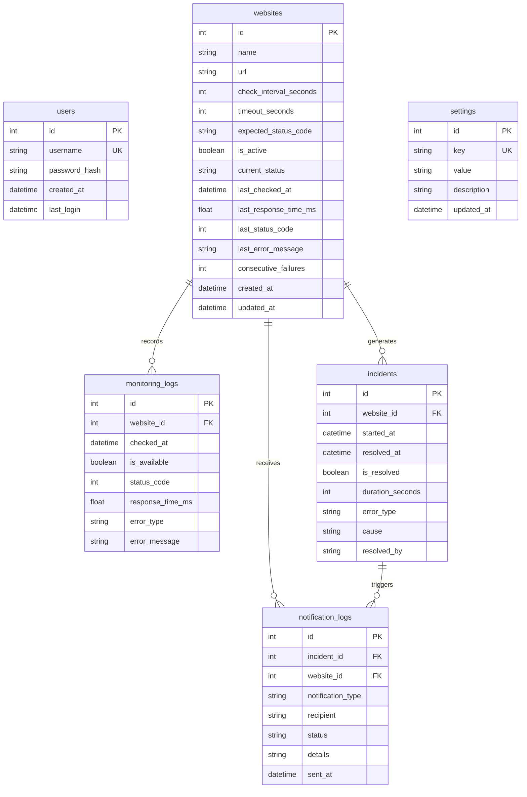
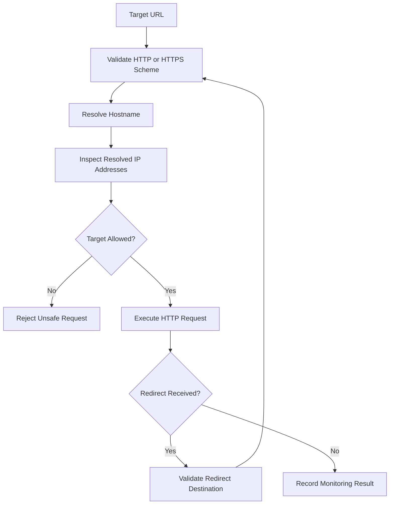

# 🛰️ UptimeGuard — Linux Automated Website Uptime Monitoring System

### Self-hosted website monitoring, automated incident detection and Linux infrastructure observability


---

## Project Overview

**UptimeGuard** is a self-hosted automated website uptime monitoring system developed using Python and Flask and deployed on Fedora Linux.

The application continuously monitors websites and HTTP/HTTPS endpoints, measures response times, records availability, detects service outages and tracks automatic recovery.

The system uses a dedicated background monitoring worker that operates independently of the web application, allowing continuous monitoring even when the administrator dashboard is closed.

The project demonstrates practical implementation of:

- Linux server administration
- Web application deployment
- Automated background processing
- Network and HTTP monitoring
- Database management
- Incident detection and recovery
- Reverse proxy configuration
- Systemd service management
- Linux security and access control

---

## Table of Contents

- [Quick Installation](#1-quick-installation-on-fedora-linux)
- [System Requirements](#2-system-requirements)
- [Application Access](#3-accessing-the-application)
- [Features](#4-key-features)
- [Technology Stack](#5-technology-stack)
- [System Architecture](#6-system-architecture)
- [Monitoring Workflow](#7-monitoring-workflow)
- [Database Architecture](#8-database-architecture)
- [Project Structure](#9-project-structure)
- [Administrator Management](#10-administrator-account-management)
- [Website Monitoring](#11-adding-and-monitoring-websites)
- [Outage and Recovery Testing](#12-controlled-outage-and-recovery-testing)
- [Linux Service Management](#13-linux-service-management)
- [Troubleshooting](#14-troubleshooting-and-debugging)
- [Manual Deployment](#15-manual-fedora-deployment)
- [Local Development](#16-local-development)
- [Automated Testing](#17-automated-testing)
- [Database Backup](#18-database-backup-and-maintenance)
- [Security](#19-security-considerations)
- [Screenshots](#20-project-screenshots)
- [Updating the Application](#21-updating-the-application)
- [Future Enhancements](#22-future-enhancements)
- [License](#23-license)

---

# 1. Quick Installation on Fedora Linux

The repository includes an automated Fedora deployment script.

A new user does not need to manually configure Python,
SQLite, Gunicorn, Nginx and Systemd individually when
the automated installation completes successfully.

> Use a dedicated Fedora virtual machine or test server.
> The deployment configures system services and Nginx.

## Step 1 — Install prerequisites

Open the Fedora terminal and execute:

```bash
sudo dnf install -y \
git \
python3 \
python3-pip \
python3-devel \
gcc \
nginx \
sqlite \
curl \
firewalld \
policycoreutils-python-utils
```

## Step 2 — Clone the repository

```bash
mkdir -p ~/projects
cd ~/projects

git clone https://github.com/sayan-de-cybersecurity/automated-website-uptime-monitoring-system.git

cd automated-website-uptime-monitoring-system
```

## Step 3 — Execute the automated installer

```bash
chmod +x scripts/setup_fedora.sh

sudo ./scripts/setup_fedora.sh
```

The installer is designed to configure:

- Required Linux packages
- Dedicated application service user
- Python virtual environment
- Python dependencies
- Application environment variables
- SQLite database
- Initial administrator account
- Gunicorn application server
- Nginx reverse proxy
- Systemd services
- SELinux permissions
- Firewall configuration

Save the administrator credentials displayed by the installer.

## Step 4 — Verify the services

```bash
sudo systemctl is-active \
uptime-monitor \
uptime-worker \
nginx
```

Expected output:

```text
active
active
active
```

Verify the Nginx configuration:

```bash
sudo nginx -t
```

Verify the application server:

```bash
curl -I http://127.0.0.1:8000/login
```

Expected HTTP status:

```text
HTTP/1.1 200 OK
```

Verify the reverse proxy:

```bash
curl -I http://localhost/login
```

## Step 5 — Open the application

Inside the Fedora virtual machine, open:

```text
http://localhost
```

Or:

```text
http://localhost/login
```

Sign in using the administrator credentials generated
during installation.

> If the Fedora Nginx welcome page appears instead of
> UptimeGuard, follow Troubleshooting Section 14.1.

> If the administrator credentials are unavailable,
> follow Section 10.

---

# 2. System Requirements

## Recommended Hardware

| Component | Minimum | Recommended |
|---|---|---|
| Processor | 2 CPU cores | 4 CPU cores |
| RAM | 2 GB | 4 GB |
| Storage | 15 GB | 25 GB |
| Network | Internet access | Stable broadband |
| Operating System | Supported Fedora Linux | Fedora Workstation |
| Virtualization | Optional | VMware Workstation |

## Software Requirements

- Fedora Linux
- Python 3.10 or later, compatible with project dependencies
- Git
- Python pip
- SQLite 3
- Nginx
- Systemd
- Firewalld
- Internet connectivity

Check the Fedora version:

```bash
cat /etc/fedora-release
```

Check the Python version:

```bash
python3 --version
```

Check internet connectivity:

```bash
curl -I https://www.google.com
```

---

# 3. Accessing the Application

## 3.1 Access from Fedora

Open a browser inside Fedora:

```text
http://localhost
```

## 3.2 Access from Windows Host

If Fedora is running inside VMware Workstation,
the application can also be accessed from the Windows host.

Find the Fedora VM IP address:

```bash
hostname -I
```

Alternatively:

```bash
ip -br addr
```

Example IP address:

```text
192.168.1.150
```

Open the following URL in the Windows browser:

```text
http://192.168.1.150
```

Replace the example IP address with the actual Fedora VM IP.

## 3.3 VMware Network Configuration

| Network Mode | Description |
|---|---|
| NAT | Fedora shares the host's internet connection |
| Bridged | Fedora receives an IP address on the local network |
| Host-only | Communication between the host and VM |

NAT is suitable for most academic demonstrations.

Bridged networking can be used when other devices on
the local network need to access the application.

Actual connectivity depends on the VMware configuration
and host firewall rules.

## 3.4 Application Ports

| Port | Service | Accessibility |
|---|---|---|
| 80 | Nginx | Local network, subject to firewall |
| 8000 | Gunicorn | Localhost only |
| 8085 | Demonstration test server | Localhost only |
| 5000 | Flask development server | Development only |

Do not expose Gunicorn directly to the public internet.

---

# 4. Key Features

## Infrastructure Overview

- Total registered websites
- Operational websites
- Unavailable websites
- Paused monitors
- Average response time
- Check-based uptime percentage
- Recent incidents
- Automatic dashboard refresh
- Interactive response time charts

## Website Monitoring

- Add, edit and delete website monitors
- Configurable monitoring intervals
- Configurable HTTP request timeouts
- Expected HTTP status code validation
- Manual health checks
- Automatic background health checks
- Pause and resume monitoring
- Website-specific performance analytics

## Incident Management

- Automatic downtime detection
- Automatic incident creation
- Duplicate incident prevention
- Failure classification
- Automatic recovery detection
- Incident resolution timestamps
- Observed downtime duration calculation

## Reports and Analytics

- Historical monitoring records
- Website availability reports
- Response time history
- Incident reports
- Date-based filtering
- CSV data export

## Linux System Monitoring

- CPU utilization
- RAM utilization
- Disk utilization
- Linux system uptime
- System load averages
- Host infrastructure information

## Administration and Security

- Administrator authentication
- Password hashing
- Password modification
- Session management
- CSRF protection
- SSRF protection mechanisms
- Optional SMTP notifications
- Dedicated Linux service account

---

# 5. Technology Stack

## Backend

| Technology | Purpose |
|---|---|
| Python | Core programming language |
| Flask | Web application framework |
| SQLAlchemy | Database ORM |
| SQLite | Relational database |
| APScheduler | Automated background scheduling |
| Requests | HTTP and HTTPS monitoring |
| Flask-Login | Authentication |
| Flask-WTF | Form validation and CSRF protection |
| Werkzeug | Password hashing and WSGI utilities |
| psutil | Linux infrastructure monitoring |

## Frontend

| Technology | Purpose |
|---|---|
| HTML5 | Application structure |
| CSS3 | Interface styling |
| JavaScript | Dynamic frontend functionality |
| Bootstrap 5 | Responsive interface |
| Chart.js | Charts and data visualization |
| Lucide Icons | Interface iconography |
| Jinja2 | Server-side HTML templates |

## Linux Infrastructure

| Technology | Purpose |
|---|---|
| Fedora Linux | Deployment operating system |
| Gunicorn | WSGI application server |
| Nginx | Reverse proxy |
| Systemd | Service lifecycle management |
| SELinux | Mandatory access control |
| Firewalld | Network firewall |
| VMware | Virtualized Linux environment |

---

# 6. System Architecture

The application uses a decoupled architecture.

The web application and background monitoring engine
operate as independent Linux services.



## Architecture Components

### Nginx

Receives incoming HTTP requests on port 80 and forwards
application requests to Gunicorn.

### Gunicorn

Runs the Flask application using multiple WSGI workers.

Gunicorn listens on:

```text
127.0.0.1:8000
```

### Flask Application

Provides authentication, dashboard views, monitor
management, reports and application APIs.

### Monitoring Worker

Runs independently using APScheduler and periodically
checks which website monitors are due for execution.

### SQLite Database

Stores administrator accounts, website configurations,
monitoring results, incidents and application settings.

### Systemd

Supervises the web application and monitoring worker,
supports automatic startup and restarts failed services.

---

# 7. Monitoring Workflow



## Monitoring Process

1. The scheduler identifies active website monitors.
2. The system checks whether a monitor is due.
3. The target URL and resolved addresses are validated.
4. An HTTP or HTTPS request is executed.
5. Response time is measured in milliseconds.
6. The received HTTP status code is evaluated.
7. The website status is updated.
8. A monitoring log is stored.
9. Incidents are created or resolved when required.
10. Updated information is displayed on the dashboard.

## Uptime Calculation

```text
Uptime Percentage =
(Successful Checks / Total Completed Checks) × 100
```

Example:

```text
Total Completed Checks = 100

Successful Checks = 98

Failed Checks = 2

Uptime = 98%
```

This is a check-based availability metric rather than
an exact measurement of every second of service availability.

## Response Time Calculation

```text
Response Time (ms) =
(End Time - Start Time) × 1000
```

## Observed Downtime Calculation

```text
Downtime Duration =
Incident Recovery Time - Incident Detection Time
```

Actual outage duration may differ because monitoring
is performed at discrete intervals.

---

# 8. Database Architecture

The system uses SQLite with SQLAlchemy ORM.

The database is stored at:

```text
/opt/linux-uptime-monitor/instance/uptime_monitor.sqlite3
```

SQLite operates using Write-Ahead Logging mode to support
concurrent database access by the application and worker.

## Database Tables

| Table | Purpose |
|---|---|
| users | Administrator accounts |
| websites | Registered website monitors |
| monitoring_logs | Historical health check records |
| incidents | Website outage and recovery records |
| notification_logs | Email notification history |
| settings | Application configuration |

## Entity Relationship Diagram



## Inspect the Database

```bash
sudo sqlite3 -readonly \
/opt/linux-uptime-monitor/instance/uptime_monitor.sqlite3
```

Inside the SQLite console:

```sql
.tables
```

Expected tables:

```text
incidents
monitoring_logs
notification_logs
settings
users
websites
```

Display registered websites:

```sql
SELECT id, name, url, current_status
FROM websites;
```

Display total completed monitoring checks:

```sql
SELECT COUNT(*) FROM monitoring_logs;
```

Display recent incidents:

```sql
SELECT id, website_id, started_at, resolved_at, is_resolved
FROM incidents
ORDER BY id DESC
LIMIT 10;
```

Exit SQLite:

```sql
.quit
```

---

# 9. Project Structure

```text
automated-website-uptime-monitoring-system/
│
├── app/
│   ├── __init__.py
│   ├── models.py
│   ├── forms.py
│   │
│   ├── routes/
│   │   ├── auth.py
│   │   ├── dashboard.py
│   │   ├── websites.py
│   │   ├── incidents.py
│   │   ├── reports.py
│   │   ├── system.py
│   │   └── settings.py
│   │
│   ├── services/
│   │   ├── checker.py
│   │   ├── incident_manager.py
│   │   ├── notifier.py
│   │   └── system_info.py
│   │
│   ├── templates/
│   │   ├── base.html
│   │   ├── auth/
│   │   ├── dashboard/
│   │   ├── websites/
│   │   ├── incidents/
│   │   ├── reports/
│   │   ├── system/
│   │   ├── settings/
│   │   └── errors/
│   │
│   └── static/
│       ├── css/
│       └── js/
│
├── monitoring/
│   ├── __init__.py
│   └── worker.py
│
├── deployment/
│   ├── nginx/
│   │   └── uptime-monitor.conf
│   │
│   └── systemd/
│       ├── uptime-monitor.service
│       └── uptime-worker.service
│
├── scripts/
│   ├── setup_fedora.sh
│   └── test_server.py
│
├── tests/
│   ├── conftest.py
│   ├── test_auth.py
│   ├── test_websites.py
│   ├── test_monitoring.py
│   ├── test_incidents.py
│   └── test_uptime.py
│
├── screenshots/
├── docs/
├── instance/               # Generated during setup
├── venv/                   # Generated during setup
├── .env                    # Generated during setup
├── .env.example
├── .gitignore
├── requirements.txt
├── pytest.ini
├── run.py
├── wsgi.py
├── LICENSE
└── README.md
```

The virtual environment, environment secrets and runtime
database must not be committed to GitHub.

---

# 10. Administrator Account Management

The automated installer is designed to create an initial
administrator account.

If the generated credentials are unavailable, follow
the instructions below.

## Step 1 — Enter the root terminal

```bash
sudo -i
```

Execute the following command separately:

```bash
cd /opt/linux-uptime-monitor
```

> Do not use `sudo cd`. The `cd` command is a shell builtin.

## Step 2 — Check existing administrator accounts

```bash
sqlite3 -readonly instance/uptime_monitor.sqlite3 \
"SELECT id, username FROM users;"
```

Example:

```text
1|admin
```

## Step 3 — Create a new administrator

Enter a strong password when prompted:

```bash
read -rsp "Enter administrator password: " ADMIN_PASSWORD
echo
```

Create the account:

```bash
sudo -u uptimemon \
/opt/linux-uptime-monitor/venv/bin/flask \
--app run:app create-admin \
--username administrator \
--password "$ADMIN_PASSWORD"
```

Clear the shell variable:

```bash
unset ADMIN_PASSWORD
```

Verify the account:

```bash
sqlite3 -readonly instance/uptime_monitor.sqlite3 \
"SELECT id, username FROM users;"
```

Example:

```text
1|admin
2|administrator
```

Exit the root shell:

```bash
exit
```

Open:

```text
http://localhost/login
```

Use:

```text
Username: administrator
Password: The password entered during account creation
```

If the username already exists, use a different username
or check the CLI's supported account-management options:

```bash
sudo -i
```

```bash
cd /opt/linux-uptime-monitor

sudo -u uptimemon ./venv/bin/flask \
--app run:app create-admin --help
```

The create-admin command should not be assumed to reset
an existing account unless that behavior is implemented.

---

# 11. Adding and Monitoring Websites

After logging in:

1. Open the Monitors section.
2. Click Add Monitor.
3. Enter the website details.
4. Configure the monitoring interval.
5. Configure the timeout.
6. Enter the expected HTTP status code.
7. Save the monitor.

## Example Monitor Configuration

| Field | Value |
|---|---|
| Monitor Name | Google |
| Target URL | https://www.google.com |
| Check Interval | 60 seconds |
| Request Timeout | 10 seconds |
| Expected Status Code | 200 |

## Example Websites

| Website | URL |
|---|---|
| Google | https://www.google.com |
| GitHub | https://github.com |
| Fedora | https://fedoraproject.org |
| Wikipedia | https://www.wikipedia.org |
| Example | https://example.com |

These are example monitoring targets. Their availability
and HTTP response codes may change.

Only monitor endpoints you are authorized to monitor,
using reasonable request intervals.

## Monitor Status Indicators

| Status | Meaning |
|---|---|
| Operational | Most recent check was successful |
| Unavailable | Most recent check failed |
| Pending | Initial health check has not completed |
| Paused | Automated monitoring is disabled |

## Verify Automated Monitoring

Wait for at least one monitoring interval.

Check registered websites:

```bash
sudo sqlite3 -readonly \
/opt/linux-uptime-monitor/instance/uptime_monitor.sqlite3 \
"SELECT id, name, current_status FROM websites;"
```

Check monitoring records:

```bash
sudo sqlite3 -readonly \
/opt/linux-uptime-monitor/instance/uptime_monitor.sqlite3 \
"SELECT COUNT(*) FROM monitoring_logs;"
```

Run the count command again after another monitoring interval.

An increasing count confirms that the background worker
is recording additional monitoring checks.

---

# 12. Controlled Outage and Recovery Testing

The project includes a local HTTP test server for
demonstrating automated outage and recovery detection.

Perform this test only in an isolated academic environment.

## Step 1 — Enable Localhost Monitoring

Enter the root terminal:

```bash
sudo -i
```

```bash
cd /opt/linux-uptime-monitor
```

Back up the environment configuration:

```bash
cp -p .env .env.before-local-test.bak
```

Edit the environment file:

```bash
nano .env
```

Find:

```env
ALLOW_LOCALHOST_MONITORING=false
```

Change it to:

```env
ALLOW_LOCALHOST_MONITORING=true
```

Save using:

```text
Ctrl + O
Enter
Ctrl + X
```

Restart both application services:

```bash
systemctl restart uptime-monitor uptime-worker
```

Exit the root shell:

```bash
exit
```

## Step 2 — Start the Test Server

Open a separate terminal:

```bash
cd ~/projects/automated-website-uptime-monitoring-system
```

If the original clone uses a different folder name,
navigate to that folder instead.

Execute:

```bash
python3 scripts/test_server.py --port 8085
```

Keep this terminal running.

The test server should be accessible at:

```text
http://127.0.0.1:8085
```

## Step 3 — Add the Test Monitor

| Field | Value |
|---|---|
| Monitor Name | Academic Test Service |
| URL | http://127.0.0.1:8085/dynamic |
| Check Interval | 10 seconds |
| Timeout | 5 seconds |
| Expected Status Code | 200 |

Verify the endpoint:

```bash
curl -i http://127.0.0.1:8085/dynamic
```

Expected initial status:

```text
HTTP 200 OK
```

## Step 4 — Simulate an Outage

Open another terminal:

```bash
curl http://127.0.0.1:8085/simulate/down
```

Verify:

```bash
curl -i http://127.0.0.1:8085/dynamic
```

Expected status:

```text
HTTP 503 Service Unavailable
```

Wait approximately 10–20 seconds, allowing for the
monitoring interval and scheduler execution.

Expected application behavior:

- Website status changes to Unavailable.
- Failed monitoring checks are recorded.
- A new incident is created.
- Repeated failures do not create duplicate open incidents.

## Step 5 — Simulate Recovery

```bash
curl http://127.0.0.1:8085/simulate/recover
```

Verify:

```bash
curl -i http://127.0.0.1:8085/dynamic
```

Expected status:

```text
HTTP 200 OK
```

After the next monitoring cycle:

- Website status returns to Operational.
- The active incident is marked Resolved.
- Recovery time is recorded.
- Observed downtime duration is calculated.

## Step 6 — Clean Up the Test Environment

Pause or delete the localhost test monitor.

Stop the test server using:

```text
Ctrl + C
```

Disable localhost monitoring:

```bash
sudo sed -i \
's/^ALLOW_LOCALHOST_MONITORING=.*/ALLOW_LOCALHOST_MONITORING=false/' \
/opt/linux-uptime-monitor/.env
```

Restart the services:

```bash
sudo systemctl restart uptime-monitor uptime-worker
```

Localhost monitoring should remain disabled during
normal operation.

---

# 13. Linux Service Management

The deployed application uses three primary services.

| Service | Responsibility |
|---|---|
| uptime-monitor | Gunicorn and Flask application |
| uptime-worker | Automated monitoring engine |
| nginx | HTTP reverse proxy |

## Check Service Status

```bash
sudo systemctl status uptime-monitor --no-pager
```

```bash
sudo systemctl status uptime-worker --no-pager
```

```bash
sudo systemctl status nginx --no-pager
```

## Start All Services

```bash
sudo systemctl start uptime-monitor uptime-worker nginx
```

## Stop All Services

```bash
sudo systemctl stop uptime-monitor uptime-worker nginx
```

## Restart All Services

```bash
sudo systemctl restart uptime-monitor uptime-worker nginx
```

## Enable Automatic Startup

```bash
sudo systemctl enable uptime-monitor uptime-worker nginx
```

## Verify Automatic Startup

```bash
sudo systemctl is-enabled uptime-monitor uptime-worker nginx
```

Expected output:

```text
enabled
enabled
enabled
```

## Reload Systemd Configuration

Execute this after modifying a systemd service file:

```bash
sudo systemctl daemon-reload
```

## Check Listening Ports

```bash
sudo ss -ltnp
```

Expected application listeners:

```text
Port 80   : Nginx
Port 8000 : Gunicorn on 127.0.0.1
```

## Verify Application After Reboot

```bash
sudo reboot
```

After Fedora restarts:

```bash
sudo systemctl is-active uptime-monitor uptime-worker nginx
```

Open:

```text
http://localhost
```

The application should start without manually running Flask.

---

# 14. Troubleshooting and Debugging

This section includes common deployment problems and
actual issues encountered during Fedora deployment.

Always inspect the error logs before changing the
application or system configuration.

---

## 14.1 Fedora Nginx Welcome Page Appears

### Problem

Opening:

```text
http://localhost
```

displays the Fedora Nginx welcome page instead of UptimeGuard.

### Cause

Fedora's default Nginx server block may conflict with
the application's reverse proxy configuration.

### Step 1 — Verify Gunicorn

```bash
curl -I http://127.0.0.1:8000
```

An HTTP 302 redirect to the login page indicates that
Gunicorn is responding.

Example:

```text
HTTP/1.1 302 FOUND
Server: gunicorn
Location: /login?next=%2F
```

### Step 2 — Back Up Nginx Configuration

```bash
sudo cp -a /etc/nginx/nginx.conf \
/etc/nginx/nginx.conf.uptimeguard.bak
```

```bash
sudo cp -a /etc/nginx/conf.d/uptime-monitor.conf \
/etc/nginx/conf.d/uptime-monitor.conf.bak
```

If the second file does not exist, skip its backup.

### Step 3 — Inspect Existing Server Blocks

```bash
sudo nginx -T 2>&1 | grep -nE \
'listen|server_name|include|configuration file'
```

Open the main Nginx configuration:

```bash
sudo nano /etc/nginx/nginx.conf
```

On a dedicated UptimeGuard VM, remove or comment out
the Fedora welcome page's default `server { ... }` block
inside the `http` section.

Do not remove unrelated virtual hosts or global settings.

Ensure the following include directive remains inside
the `http` section:

```nginx
include /etc/nginx/conf.d/*.conf;
```

### Step 4 — Configure the Application Reverse Proxy

```bash
sudo nano /etc/nginx/conf.d/uptime-monitor.conf
```

For a dedicated UptimeGuard server, use:

```nginx
server {

    listen 80 default_server;
    listen [::]:80 default_server;

    server_name _;

    client_max_body_size 10M;

    access_log /var/log/nginx/uptime-monitor-access.log;
    error_log /var/log/nginx/uptime-monitor-error.log;

    add_header X-Content-Type-Options nosniff always;
    add_header X-Frame-Options SAMEORIGIN always;
    add_header Referrer-Policy strict-origin-when-cross-origin always;

    location / {

        proxy_pass http://127.0.0.1:8000;

        proxy_http_version 1.1;

        proxy_set_header Host $host;
        proxy_set_header X-Real-IP $remote_addr;

        proxy_set_header X-Forwarded-For
                         $proxy_add_x_forwarded_for;

        proxy_set_header X-Forwarded-Proto $scheme;

        proxy_connect_timeout 60s;
        proxy_send_timeout 60s;
        proxy_read_timeout 60s;

        proxy_redirect off;
    }
}
```

Only one default server should exist for each listening
address and port.

On a shared Nginx server, use a dedicated hostname
instead of replacing the existing default virtual host.

### Step 5 — Configure SELinux

```bash
sudo setsebool -P httpd_can_network_connect 1
```

### Step 6 — Validate and Restart Nginx

```bash
sudo nginx -t
```

If validation succeeds:

```bash
sudo systemctl restart nginx
```

Open:

```text
http://localhost
```

The UptimeGuard login page should appear.

If Nginx validation fails, correct the reported error
or restore the configuration backup before restarting.

---

## 14.2 HTTP 502 Bad Gateway

### Possible Causes

- Gunicorn is not running.
- Gunicorn is listening on an incorrect port.
- Nginx reverse proxy configuration is incorrect.
- SELinux is blocking the proxy connection.

### Diagnosis

```bash
sudo systemctl status uptime-monitor --no-pager
```

```bash
curl -I http://127.0.0.1:8000/login
```

```bash
sudo getsebool httpd_can_network_connect
```

```bash
sudo tail -n 50 \
/var/log/nginx/uptime-monitor-error.log
```

### Solution

```bash
sudo systemctl restart uptime-monitor
```

```bash
sudo setsebool -P httpd_can_network_connect 1
```

```bash
sudo nginx -t
```

```bash
sudo systemctl restart nginx
```

Do not disable SELinux to resolve this issue.

---

## 14.3 HTTP 500 Internal Server Error

### Problem

The login page works, but the dashboard or another
application page displays:

```text
500 - Internal Server Error
```

### Inspect Gunicorn Error Logs

```bash
sudo tail -n 100 \
/var/log/uptime-monitor/gunicorn-error.log
```

For live debugging:

```bash
sudo tail -n 0 -F \
/var/log/uptime-monitor/gunicorn-error.log
```

Keep the terminal running and refresh the affected
page in the browser.

The Python traceback should identify the affected file,
line number and error type.

Press Ctrl+C to stop live log monitoring.

---

## 14.4 Missing Python `os` Import

### Problem

Adding a website produces an HTTP 500 error.

The error log contains:

```text
NameError: name 'os' is not defined
```

### Affected File

```text
app/routes/websites.py
```

### Cause

The route uses:

```python
os.environ.get(...)
```

without importing the Python `os` module.

### Solution

Enter the root terminal:

```bash
sudo -i
```

```bash
cd /opt/linux-uptime-monitor
```

Back up the affected file:

```bash
cp app/routes/websites.py app/routes/websites.py.bak
```

Edit the file:

```bash
nano app/routes/websites.py
```

Add the following import alongside the other imports:

```python
import os
```

If the file contains `from __future__` imports, keep
those imports before the new standard-library import.

Save and exit.

Validate Python syntax:

```bash
./venv/bin/python -m py_compile app/routes/websites.py
```

Restart the web application:

```bash
systemctl restart uptime-monitor
```

This correction should already be present in the
updated source code.

---

## 14.5 Jinja2 Endpoint Error

### Problem

An error page fails to render and the log contains:

```text
jinja2.exceptions.UndefinedError:
'None' has no attribute 'startswith'
```

### Affected File

```text
app/templates/base.html
```

### Incorrect Code

```jinja2

```

### Correct Code

```jinja2

```

The corrected expression handles requests where
`request.endpoint` is None.

### Automated Correction

From the root terminal:

```bash
cd /opt/linux-uptime-monitor
```

```bash
cp app/templates/base.html app/templates/base.html.bak
```

```bash
python3 - <<'PY'
from pathlib import Path

path = Path("app/templates/base.html")
source = path.read_text()

source = source.replace(
    "request.endpoint.startswith(",
    "(request.endpoint or '').startswith("
)

path.write_text(source)

print("Endpoint conditions corrected.")
PY
```

Restart the web application:

```bash
systemctl restart uptime-monitor
```

This correction should already be present in the
updated source code.

---

## 14.6 Dashboard Overview Returns HTTP 500

### Problem

The monitoring worker is running and website records
exist, but the Overview page returns HTTP 500.

### Error

```text
jinja2.exceptions.TemplateRuntimeError:
No test named 'None' found.
```

### Affected File

```text
app/templates/dashboard/index.html
```

### Incorrect Code

```jinja2

```

### Correct Code

```jinja2

```

Python uses `None`, whereas the Jinja2 null test
is named `none`.

### Solution

```bash
sudo -i
```

```bash
cd /opt/linux-uptime-monitor
```

```bash
cp app/templates/dashboard/index.html \
app/templates/dashboard/index.html.bak
```

```bash
sed -i 's/is not None/is not none/g' \
app/templates/dashboard/index.html
```

Search for similar errors:

```bash
grep -RnE 'is (not )?None' \
app/templates/ --include="*.html"
```

Review any matching expressions and correct Jinja2
null tests where required.

Restart the application:

```bash
systemctl restart uptime-monitor
```

Open:

```text
http://localhost/dashboard
```

Perform a hard refresh:

```text
Ctrl + Shift + R
```

This correction should already be present in the
updated source code.

---

## 14.7 Permission Denied in Installation Directory

### Problem

```bash
cd /opt/linux-uptime-monitor
```

Returns:

```text
Permission denied
```

### Cause

The installation directory belongs to the dedicated
Linux application service account.

### Solution

```bash
sudo -i
```

Then execute separately:

```bash
cd /opt/linux-uptime-monitor
```

Do not execute:

```bash
sudo cd /opt/linux-uptime-monitor
```

Do not use `chmod -R 777` to bypass permissions.

---

## 14.8 SQLite Database Permission Error

### Problem

```text
sqlite3.OperationalError:
unable to open database file
```

Or:

```text
attempt to write a readonly database
```

### Inspect Permissions

```bash
sudo ls -ld /opt/linux-uptime-monitor
```

```bash
sudo ls -la /opt/linux-uptime-monitor/instance/
```

### Solution

```bash
sudo chown -R uptimemon:uptimemon \
/opt/linux-uptime-monitor/instance
```

```bash
sudo chmod 770 \
/opt/linux-uptime-monitor/instance
```

```bash
sudo find /opt/linux-uptime-monitor/instance \
-type f -name 'uptime_monitor.sqlite3*' \
-exec chmod 660 {} +
```

Restart the services:

```bash
sudo systemctl restart uptime-monitor uptime-worker
```

Verify database access using the service account:

```bash
sudo -u uptimemon sqlite3 -readonly \
/opt/linux-uptime-monitor/instance/uptime_monitor.sqlite3 \
".tables"
```

---

## 14.9 Monitoring Worker Is Running but No Checks Occur

### Step 1 — Verify the Worker

```bash
sudo systemctl status uptime-worker --no-pager
```

### Step 2 — Inspect Worker Logs

```bash
sudo tail -n 100 \
/var/log/uptime-monitor/worker-error.log
```

```bash
sudo tail -n 100 \
/var/log/uptime-monitor/worker.log
```

### Step 3 — Check Registered Websites

```bash
sudo sqlite3 -readonly \
/opt/linux-uptime-monitor/instance/uptime_monitor.sqlite3 \
"SELECT id, name, is_active, current_status FROM websites;"
```

If no websites are registered, add a monitor.

If the monitor is paused, resume it.

### Step 4 — Verify Monitoring Logs

```bash
sudo sqlite3 -readonly \
/opt/linux-uptime-monitor/instance/uptime_monitor.sqlite3 \
"SELECT COUNT(*) FROM monitoring_logs;"
```

Wait for another monitoring interval and repeat the command.

### Step 5 — Verify Network Connectivity

```bash
curl -I https://www.google.com
```

Restart the worker if necessary:

```bash
sudo systemctl restart uptime-worker
```

A successful scheduler dispatch message alone does not
prove that a website check was completed.

An increasing monitoring log count is a stronger
verification of automated monitoring.

---

## 14.10 Cannot Access Application from Windows

### Check Fedora IP Address

```bash
hostname -I
```

### Check Firewall

```bash
sudo systemctl status firewalld --no-pager
```

```bash
sudo firewall-cmd --get-active-zones
```

On a trusted academic network, allow HTTP in the
appropriate active firewall zone:

```bash
sudo firewall-cmd --permanent --add-service=http
```

```bash
sudo firewall-cmd --reload
```

Verify:

```bash
sudo firewall-cmd --list-all
```

If the VM network interface uses a non-default zone,
specify that zone using `--zone=ZONE_NAME`.

### Check Nginx

```bash
sudo systemctl status nginx --no-pager
```

```bash
sudo ss -ltnp | grep ':80'
```

Ensure VMware networking allows communication between
the Windows host and Fedora VM.

Do not expose the application to an untrusted network
without HTTPS and appropriate access restrictions.

---

## 14.11 Administrator Login Not Working

Inspect existing accounts:

```bash
sudo sqlite3 -readonly \
/opt/linux-uptime-monitor/instance/uptime_monitor.sqlite3 \
"SELECT id, username FROM users;"
```

If the required administrator account does not exist,
create a new account using Section 10.

Never modify password hashes manually in SQLite.

If the login page itself is unavailable:

```bash
curl -I http://127.0.0.1:8000/login
```

```bash
sudo tail -n 100 \
/var/log/uptime-monitor/gunicorn-error.log
```

---

## 14.12 Duplicate Nginx Default Server Error

### Error

```text
a duplicate default server for 0.0.0.0:80
```

### Solution

Inspect all active Nginx configurations:

```bash
sudo nginx -T
```

Ensure that only one server block is marked as
`default_server` for each address and port.

On a dedicated project VM, disable the Fedora welcome
page's conflicting default server block.

Validate:

```bash
sudo nginx -t
```

Restart only after validation succeeds:

```bash
sudo systemctl restart nginx
```

---

## 14.13 Complete Diagnostic Commands

Execute the following commands when investigating
an unknown deployment issue:

```bash
sudo systemctl is-active \
uptime-monitor uptime-worker nginx
```

```bash
sudo systemctl status uptime-monitor --no-pager
```

```bash
sudo systemctl status uptime-worker --no-pager
```

```bash
sudo systemctl status nginx --no-pager
```

```bash
sudo nginx -t
```

```bash
sudo ss -ltnp
```

```bash
curl -I http://127.0.0.1:8000/login
```

```bash
curl -I http://localhost/login
```

```bash
sudo journalctl -u uptime-monitor -n 100 --no-pager
```

```bash
sudo journalctl -u uptime-worker -n 100 --no-pager
```

```bash
sudo tail -n 100 \
/var/log/uptime-monitor/gunicorn-error.log
```

```bash
sudo tail -n 100 \
/var/log/uptime-monitor/worker-error.log
```

```bash
sudo tail -n 100 \
/var/log/nginx/uptime-monitor-error.log
```

## Important Log File Locations

| Log File | Purpose |
|---|---|
| gunicorn-error.log | Python and application exceptions |
| gunicorn-access.log | Incoming application requests |
| worker.log | Background worker standard output |
| worker-error.log | Scheduler activity and worker errors |
| uptime-monitor-access.log | Nginx request logs |
| uptime-monitor-error.log | Nginx reverse proxy errors |

Application logs are stored in:

```text
/var/log/uptime-monitor/
```

Nginx logs are stored in:

```text
/var/log/nginx/
```

---

# 15. Manual Fedora Deployment

The automated installer is recommended.

Use the manual deployment procedure if the automated
installer fails or if individual Linux configuration
steps are required for academic evaluation.

Perform these steps on a fresh dedicated Fedora VM.

## Step 1 — Install Dependencies

```bash
sudo dnf install -y \
python3 python3-devel python3-pip gcc \
nginx firewalld policycoreutils-python-utils \
sqlite git curl
```

## Step 2 — Create Service Account

```bash
id uptimemon >/dev/null 2>&1 || \
sudo useradd --system \
--user-group \
--shell /sbin/nologin \
uptimemon
```

## Step 3 — Create Deployment Directories

```bash
sudo mkdir -p /opt/linux-uptime-monitor
```

```bash
sudo mkdir -p /opt/linux-uptime-monitor/instance
```

```bash
sudo mkdir -p /var/log/uptime-monitor
```

## Step 4 — Clone and Copy the Repository

```bash
mkdir -p ~/projects
cd ~/projects
```

```bash
git clone https://github.com/sayan-de-cybersecurity/automated-website-uptime-monitoring-system.git
```

```bash
cd automated-website-uptime-monitoring-system
```

Copy the source code:

```bash
git archive HEAD | \
sudo tar -x -C /opt/linux-uptime-monitor
```

This copies committed project files without copying
the Git repository metadata.

## Step 5 — Configure Ownership

```bash
sudo chown -R uptimemon:uptimemon \
/opt/linux-uptime-monitor
```

```bash
sudo chown -R uptimemon:uptimemon \
/var/log/uptime-monitor
```

```bash
sudo chmod 750 /opt/linux-uptime-monitor
```

```bash
sudo chmod 770 /opt/linux-uptime-monitor/instance
```

## Step 6 — Create Python Virtual Environment

```bash
sudo -u uptimemon python3 -m venv \
/opt/linux-uptime-monitor/venv
```

```bash
sudo -u uptimemon \
/opt/linux-uptime-monitor/venv/bin/pip \
install --upgrade pip setuptools wheel
```

```bash
sudo -u uptimemon \
/opt/linux-uptime-monitor/venv/bin/pip \
install -r /opt/linux-uptime-monitor/requirements.txt
```

```bash
sudo -u uptimemon \
/opt/linux-uptime-monitor/venv/bin/pip \
install gunicorn
```

## Step 7 — Configure Environment Variables

```bash
sudo -i
```

```bash
cd /opt/linux-uptime-monitor
```

```bash
cp .env.example .env
```

Generate a secure secret key:

```bash
python3 -c "import secrets; print(secrets.token_hex(32))"
```

Edit the environment file:

```bash
nano .env
```

Example configuration:

```env
FLASK_APP=run.py
FLASK_ENV=production
SECRET_KEY=REPLACE_WITH_GENERATED_SECRET_KEY

DATABASE_PATH=instance/uptime_monitor.sqlite3

DEFAULT_MONITOR_INTERVAL_SECONDS=60
DEFAULT_REQUEST_TIMEOUT_SECONDS=10

ALLOW_LOCALHOST_MONITORING=false

SMTP_ENABLED=false
SMTP_SERVER=smtp.gmail.com
SMTP_PORT=587
SMTP_USE_TLS=true
SMTP_USERNAME=
SMTP_PASSWORD=
ALERT_EMAIL_RECIPIENT=
ALERT_EMAIL_SENDER=no-reply@uptime-monitor.local
```

Use the generated secret key instead of the placeholder.

Retain any additional variables required by `.env.example`.

Secure the environment file:

```bash
chown uptimemon:uptimemon .env
chmod 600 .env
```

## Step 8 — Initialize the Database

```bash
sudo -u uptimemon ./venv/bin/flask \
--app run:app init-db
```

## Step 9 — Create Administrator Account

```bash
read -rsp "Enter administrator password: " ADMIN_PASSWORD
echo
```

```bash
sudo -u uptimemon ./venv/bin/flask \
--app run:app create-admin \
--username administrator \
--password "$ADMIN_PASSWORD"
```

```bash
unset ADMIN_PASSWORD
```

## Step 10 — Install Systemd Services

```bash
cp deployment/systemd/uptime-monitor.service \
/etc/systemd/system/
```

```bash
cp deployment/systemd/uptime-worker.service \
/etc/systemd/system/
```

```bash
systemctl daemon-reload
```

```bash
systemctl enable --now uptime-monitor uptime-worker
```

## Step 11 — Configure Nginx

```bash
cp deployment/nginx/uptime-monitor.conf \
/etc/nginx/conf.d/uptime-monitor.conf
```

Check for a conflicting Fedora default server block.

Follow Section 14.1 if necessary.

Configure SELinux:

```bash
setsebool -P httpd_can_network_connect 1
```

Validate Nginx:

```bash
nginx -t
```

If validation succeeds:

```bash
systemctl enable --now nginx
systemctl restart nginx
```

## Step 12 — Configure Firewall

For a dedicated academic VM on a trusted network:

```bash
systemctl enable --now firewalld
```

```bash
firewall-cmd --permanent --add-service=http
```

```bash
firewall-cmd --reload
```

## Step 13 — Verify Installation

```bash
systemctl is-active uptime-monitor uptime-worker nginx
```

```bash
curl -I http://127.0.0.1:8000/login
```

```bash
curl -I http://localhost/login
```

Exit the root shell:

```bash
exit
```

Open:

```text
http://localhost
```

---

# 16. Local Development

The application can also be developed locally without
Nginx or Systemd.

The Flask development server must not be used as
the public production server.

## Windows Development

Open PowerShell:

```powershell
git clone https://github.com/sayan-de-cybersecurity/automated-website-uptime-monitoring-system.git
```

```powershell
cd automated-website-uptime-monitoring-system
```

Create the virtual environment:

```powershell
python -m venv venv
```

Install dependencies:

```powershell
.\venv\Scripts\python.exe -m pip install -r requirements.txt
```

Create the environment file:

```powershell
Copy-Item .env.example .env
```

Configure a unique secret key and other required
environment variables in `.env`.

Initialize the database:

```powershell
.\venv\Scripts\python.exe -m flask --app run:app init-db
```

Create a local administrator using a unique password:

```powershell
.\venv\Scripts\python.exe -m flask --app run:app create-admin --username admin --password "REPLACE_WITH_LOCAL_PASSWORD"
```

Start the Flask development server:

```powershell
.\venv\Scripts\python.exe run.py
```

Open a second PowerShell terminal in the project directory:

```powershell
.\venv\Scripts\python.exe monitoring\worker.py
```

Open:

```text
http://127.0.0.1:5000
```

## Linux Development

```bash
git clone https://github.com/sayan-de-cybersecurity/automated-website-uptime-monitoring-system.git
```

```bash
cd automated-website-uptime-monitoring-system
```

```bash
python3 -m venv venv
```

```bash
source venv/bin/activate
```

```bash
pip install -r requirements.txt
```

```bash
cp .env.example .env
```

Configure a unique secret key in `.env`.

```bash
flask --app run:app init-db
```

```bash
read -rsp "Enter local administrator password: " ADMIN_PASSWORD
echo
```

```bash
flask --app run:app create-admin \
--username admin \
--password "$ADMIN_PASSWORD"
```

```bash
unset ADMIN_PASSWORD
```

Terminal 1:

```bash
python run.py
```

Terminal 2:

```bash
source venv/bin/activate
python monitoring/worker.py
```

Open:

```text
http://127.0.0.1:5000
```

Do not start an additional monitoring worker against
the deployed database when the Systemd worker is running.

---

# 17. Automated Testing

The repository includes a Pytest test suite covering:

- Administrator authentication
- Invalid login attempts
- Password modification
- Website management
- URL validation
- SSRF protection
- Successful HTTP checks
- Failed HTTP checks
- Connection timeouts
- SSL errors
- Incident creation
- Duplicate incident prevention
- Automatic incident recovery
- Uptime calculations
- CSV exports

Run tests from the cloned development repository,
not against the live deployment database.

## Linux

```bash
source venv/bin/activate
```

```bash
python -m pip install pytest
```

```bash
python -m pytest -v
```

## Windows

```powershell
.\venv\Scripts\python.exe -m pip install pytest
```

```powershell
.\venv\Scripts\python.exe -m pytest -v
```

## Run Individual Test Suites

```bash
python -m pytest tests/test_auth.py -v
```

```bash
python -m pytest tests/test_websites.py -v
```

```bash
python -m pytest tests/test_monitoring.py -v
```

```bash
python -m pytest tests/test_incidents.py -v
```

```bash
python -m pytest tests/test_uptime.py -v
```

The original project documentation listed 23 tests.

Run the suite on the current revision to obtain the
actual test count and pass/fail results.

## Manual Acceptance Testing

- [ ] Administrator login works.
- [ ] Dashboard loads without HTTP 500 errors.
- [ ] Website registration works.
- [ ] Website editing works.
- [ ] Website deletion works.
- [ ] Manual health checks work.
- [ ] Automated monitoring records are increasing.
- [ ] Response times are displayed.
- [ ] Dashboard charts load correctly.
- [ ] Pause and resume functionality works.
- [ ] Downtime detection works.
- [ ] Duplicate incidents are prevented.
- [ ] Automatic recovery works.
- [ ] Reports load correctly.
- [ ] CSV exports work.
- [ ] Linux system telemetry is displayed.
- [ ] Services start automatically after reboot.
- [ ] Fresh Fedora installation completes successfully.

---

# 18. Database Backup and Maintenance

## Database Location

```text
/opt/linux-uptime-monitor/instance/uptime_monitor.sqlite3
```

## Create a Database Backup

Enter the root terminal:

```bash
sudo -i
```

```bash
mkdir -p /var/backups/uptimeguard
chmod 700 /var/backups/uptimeguard
```

Create a consistent SQLite backup:

```bash
sqlite3 /opt/linux-uptime-monitor/instance/uptime_monitor.sqlite3 \
".backup '/var/backups/uptimeguard/uptime_monitor_$(date +%F_%H%M%S).sqlite3'"
```

Protect the backup files:

```bash
chmod 600 /var/backups/uptimeguard/*.sqlite3
```

Verify:

```bash
ls -lh /var/backups/uptimeguard/
```

Using SQLite's backup command is preferable to copying
only the main database file while WAL mode is active.

## Check Database Integrity

```bash
sqlite3 -readonly \
/opt/linux-uptime-monitor/instance/uptime_monitor.sqlite3 \
"PRAGMA integrity_check;"
```

Expected output:

```text
ok
```

## Check Database Journal Mode

```bash
sqlite3 -readonly \
/opt/linux-uptime-monitor/instance/uptime_monitor.sqlite3 \
"PRAGMA journal_mode;"
```

Expected output:

```text
wal
```

## Check Monitoring Statistics

```bash
sqlite3 -readonly \
/opt/linux-uptime-monitor/instance/uptime_monitor.sqlite3 \
"SELECT COUNT(*) FROM monitoring_logs;"
```

Exit the root terminal:

```bash
exit
```

Database backups contain administrator password hashes
and monitoring information. Keep them private.

---

# 19. Security Considerations

The application incorporates several security mechanisms.

| Security Mechanism | Purpose |
|---|---|
| Password hashing | Protect stored passwords |
| CSRF protection | Protect authenticated form submissions |
| SSRF validation | Restrict unsafe monitoring targets |
| Session authentication | Restrict administrative access |
| Dedicated service user | Reduce application privileges |
| SELinux | Enforce Linux access controls |
| Firewalld | Restrict network access |
| Environment configuration | Keep secrets outside source code |
| Gunicorn loopback binding | Prevent direct external WSGI access |

These controls do not replace a comprehensive security
audit or production hardening process.

## Important Security Rules

- Never commit `.env` to GitHub.
- Never commit the live SQLite database.
- Never commit administrator passwords.
- Never commit SMTP credentials.
- Never commit the Python virtual environment.
- Never disable SELinux as a troubleshooting shortcut.
- Never use `chmod -R 777`.
- Never expose Gunicorn port 8000 publicly.
- Keep localhost monitoring disabled during normal operation.
- Use strong and unique administrator passwords.
- Configure HTTPS before public deployment.
- Use a supported Fedora release and install security updates.
- Restrict access to the administrative dashboard.

## Recommended `.gitignore`

```gitignore
# Environment variables
.env
.env.*
!.env.example

# Python virtual environments
venv/
.venv/
env/

# Python cache
__pycache__/
*.py[cod]
.pytest_cache/
.coverage

# Runtime databases
instance/
*.sqlite3
*.sqlite3-wal
*.sqlite3-shm
*.db
*.db-wal
*.db-shm

# Logs and backups
*.log
*.bak

# IDE configuration
.vscode/
.idea/

# Operating system files
.DS_Store
Thumbs.db
```

## SSRF Protection Workflow



The application is designed to restrict unsafe target
addresses and validate redirects.

The protection should be reviewed and tested before
allowing untrusted users to register monitoring targets.

---

# 20. Project Screenshots

The following screenshot filenames are recommended
for documenting the completed project.

Save actual application screenshots in the
`screenshots/` directory using these filenames.

| Screenshot | Filename |
|---|---|
| Administrator Login | 00_login.png |
| Infrastructure Overview | 01_overview_dashboard.png |
| Website Monitors | 02_monitors_list.png |
| Website Analytics | 03_website_detail_analytics.png |
| Incident Management | 04_incident_management.png |
| Linux System Telemetry | 05_system_telemetry.png |
| Reports and CSV Exports | 06_csv_reports.png |
| Application Settings | 07_settings.png |
| Fedora Service Status | 08_fedora_services.png |
| Outage Simulation | 09_outage_simulation.png |
| Automatic Recovery | 10_automatic_recovery.png |

Once the screenshots exist, they can be embedded
in this README using the following Markdown syntax:

```markdown


```

Remove or redact credentials, private URLs and sensitive
information before uploading screenshots.

---

# 21. Updating the Application

The cloned Git repository and the deployed application
directory are separate.

Running `git pull` in the cloned repository does not
automatically update the application under `/opt`.

## Step 1 — Download Latest Source Code

```bash
cd ~/projects/automated-website-uptime-monitoring-system
```

```bash
git pull origin main
```

If the repository was cloned under another directory name,
navigate to that directory instead.

## Step 2 — Back Up the Database

Follow the backup procedure in Section 18.

Also securely back up the existing `.env` file.

## Step 3 — Stop Application Services

```bash
sudo systemctl stop uptime-monitor uptime-worker
```

## Step 4 — Update Application Source

Install rsync if necessary:

```bash
sudo dnf install -y rsync
```

From the cloned repository:

```bash
sudo rsync -av \
--exclude='.git/' \
--exclude='.env' \
--exclude='.env.*' \
--exclude='instance/' \
--exclude='venv/' \
--exclude='.venv/' \
--exclude='__pycache__/' \
--exclude='*.bak' \
--exclude='*.log' \
./ /opt/linux-uptime-monitor/
```

The command preserves the existing database,
environment configuration and virtual environment.

## Step 5 — Restore Application Ownership

```bash
sudo chown -R uptimemon:uptimemon \
/opt/linux-uptime-monitor
```

## Step 6 — Update Python Dependencies

```bash
sudo -u uptimemon \
/opt/linux-uptime-monitor/venv/bin/pip \
install -r /opt/linux-uptime-monitor/requirements.txt
```

Review release notes for any required database schema
changes before restarting the application.

## Step 7 — Restart Application Services

```bash
sudo systemctl daemon-reload
```

```bash
sudo systemctl start uptime-monitor uptime-worker
```

If the release modifies Nginx or Systemd configuration
files, review and install those changes separately.

## Step 8 — Verify the Application

```bash
sudo systemctl is-active uptime-monitor uptime-worker nginx
```

```bash
curl -I http://localhost/login
```

Open the dashboard and verify that monitoring records
continue to increase.

---

# 22. Future Enhancements

- [ ] Multi-user administration
- [ ] Role-based access control
- [ ] Multi-factor authentication
- [ ] SSL certificate expiration monitoring
- [ ] Domain expiration monitoring
- [ ] TCP port monitoring
- [ ] ICMP ping monitoring
- [ ] Distributed monitoring agents
- [ ] Public service status pages
- [ ] Slack and Discord notifications
- [ ] Telegram notifications
- [ ] Webhook integrations
- [ ] PostgreSQL database support
- [ ] Docker-based deployment
- [ ] Automated database backup scheduling
- [ ] Advanced availability reports
- [ ] AI-based anomaly detection
- [ ] Historical performance forecasting
- [ ] Mobile-responsive progressive web application

---

# 23. License

This project is developed for academic and educational
purposes.

Refer to the [LICENSE](LICENSE) file for the applicable
license terms.

Existing contributor acknowledgements and license
requirements must be retained when redistributing
or modifying this project.

---

## Academic Learning Outcomes

This project demonstrates practical knowledge of:

- Linux operating system administration
- Python application development
- Flask web development
- Database design and management
- HTTP and HTTPS networking
- Automated task scheduling
- Linux process management
- Systemd service configuration
- Nginx reverse proxy deployment
- Gunicorn application hosting
- Linux firewall management
- SELinux security configuration
- Application debugging
- Infrastructure observability
- Incident management
- Git and GitHub version control

---

## Conclusion

UptimeGuard demonstrates how an automated infrastructure
monitoring platform can be developed and deployed using
open-source technologies on Linux.

The combination of Flask, SQLite, APScheduler, Gunicorn,
Nginx and Systemd provides a lightweight foundation for
continuous website monitoring and infrastructure
observability.

The separation of the web application and monitoring
worker allows background monitoring to continue
independently of the administrator interface.

The project provides a practical academic implementation
of Linux server deployment, automated monitoring,
incident detection and application troubleshooting.

---

## Repository

**Project:** Linux Automated Website Uptime Monitoring System

**Application:** UptimeGuard

**Repository URL:**

https://github.com/sayan-de-cybersecurity/automated-website-uptime-monitoring-system

---

<div align="center">

### 🛰️ UptimeGuard

**Monitor. Detect. Recover.**

*Built with Python. Engineered for Linux.*


[Back to Top](#-uptimeguard--linux-automated-website-uptime-monitoring-system)

</div>
